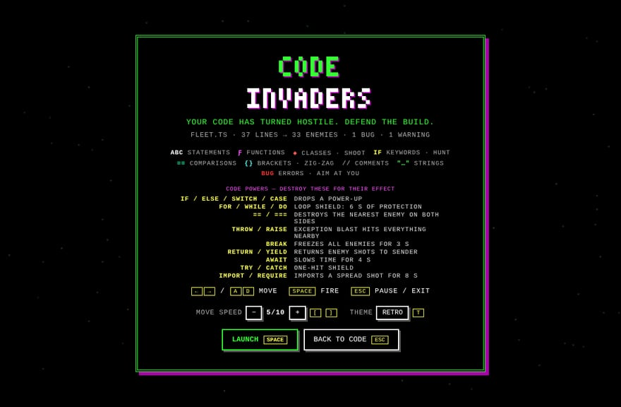
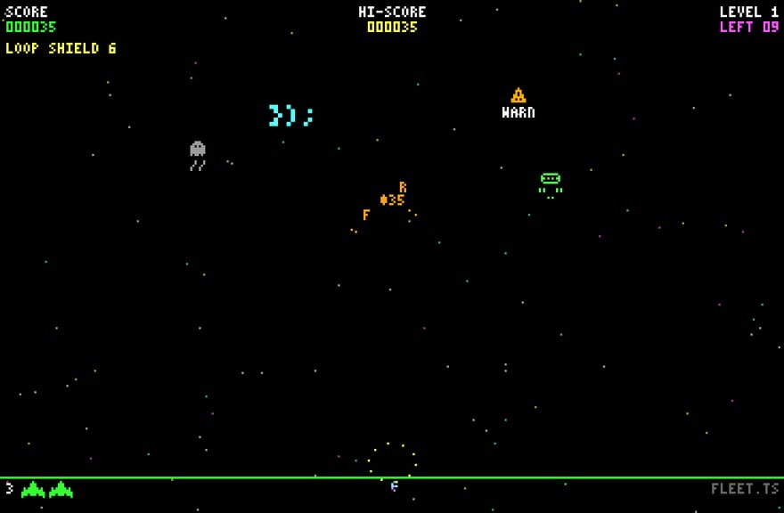

# Code Invaders

A retro space shooter where **the code you write becomes the enemy**. Run one command and your
current editor tab turns into an old-school arcade cabinet: the loops, conditionals, functions,
classes, promises and compiler errors in the file descend on your ship — each one fighting the way
its code *behaves* — and every level ends with a boss built from your source.




## Features

- **Plays in the tab you're in.** The game takes over the active editor tab (same group, same position).
  Exit and your file comes back exactly where it was — cursor, selection and scroll position included.
- **Your code is the wave.** A syntax-aware parser (JavaScript / TypeScript, including JSX/TSX)
  finds the real constructs in the active document and turns each one into an enemy whose abilities
  match what the code does. Related syntax is grouped into one meaningful enemy: a `for` header is one
  Loop Commander (not three enemies for `i`, `i < n` and `i++`), loops nested inside it become its
  escorts, an `if / else if / else` chain is one conditional, every `&&`/`||` in an expression is one
  logic enemy, `await`s are folded into their async function. Labels come from your source
  (`if speed > 9`, `fib()`, `const ship`). Other languages use an indentation-based fallback.

  **Tier 1 — basic**

  | Code | Enemy | Ability |
  | --- | --- | --- |
  | `if` / `switch` | **if Bot** — conditional | flanks the side of you its condition picks; dodges a shot when the condition flips |
  | `&&` | **&& Bot** — double strike | fires two shots that land together; `&&` + `\|\|` in one expression adds an aimed pair |
  | `\|\|` | **\|\| Bot** — splitter | often splits into two weaker halves (labelled with each side) when hit; alternates patterns |
  | arrow function `=>` | **=> Bot** — arrow | marks a dash line, dashes to a new spot, then fires |
  | `return` | **return Bot** — escape | flees upward once damaged; if it gets away, its points go with it |

  **Tier 2 — intermediate**

  | Code | Enemy | Ability |
  | --- | --- | --- |
  | function / method | **function Bot** | fixed, predictable fan pattern; summons its **parameters** as support units, which vanish with it |
  | `const` | **const Bot** — static defender | parks in a fixed lane behind a shield; slow, accurate shots |
  | `let` / `var` | **let Bot** — adaptive | reassigns itself between `AGGRO` (chases, fires more) and `GUARD` (hangs back, half damage) |
  | `while` / `do…while` | **while Bot** — loop | repeats a sweep-and-fire cycle that grows each time — at most 4 cycles, then `break;` |
  | `class` | **class Bot** — elite | rotates spread / aimed / ring attacks and spawns its **methods**; big reward |
  | `try / catch` | **try/catch Bot** — recovery | catches damage: a timed shield (with a visible bar), then a cooldown |

  **Tier 3 — dangerous**

  | Code | Enemy | Ability |
  | --- | --- | --- |
  | `for` | **Loop Commander** | see below |
  | `async` / `await` | **async/await Bot** — time-warp | vanishes, marks where it will reappear, returns with a new telegraphed attack |
  | `Promise`, `.then()` | **Promise Bot** — delayed attack | charges a pending orb that resolves into a small, clearly marked burst |
  | `import` / `require` | **import Bot** — reinforcement | enters from the screen edge and calls a few real lines of your code as reinforcements |
  | `throw` | **throw Bot** — projectile specialist | visible wind-up, then a heavy shot at where you *were* |
  | recursive function | **recursive Bot** — clone | creates weaker, smaller copies of itself — depth ≤ 2, ≤ 3 alive per family |

  Everything else stays a classic enemy:

  | Code | Enemy | Behaviour |
  | --- | --- | --- |
  | `==` / `===` comparisons | twin pods | extra enemy for every line that compares — see code powers |
  | Statements | `abc` saucer | sways while descending |
  | Functions / methods | `ƒ name()` fighter | tougher; shoots from level 2 |
  | Classes, interfaces, structs, enums | `◆ Name` mothership | mini-boss, 3-way spread shot, always drops a power-up |
  | `if` `for` `return` `throw` … | diamond dart | homes in on your ship |
  | Bracket-only lines `});` | spinning glyph | fast zig-zag |
  | Comments | ghost | slow, phases in and out |
  | String literals | capsule | — |
  | **Errors** (diagnostics) | red `BUG` beetle | aims at you; destroying it shows the error message |
  | **Warnings** | yellow `WARN` beetle | fires straight down |

- **Loop Commander.** `for (let i = 0; i < 10; i++)` becomes a big `for` ship with a small `i` escort
  and its signature `i < 10; i++` shown on arrival and at every attack cycle. Each loop iteration is
  one attack cycle (volley → fan → aimed pair, following the loop's phases) while it moves between
  lanes. Escorts **intercept** your shots (3 each), and even when they're out of charges the commander
  takes only half damage while any escort lives. Destroy every escort and the **core is exposed** for
  4 s (double damage). Killing the commander removes its surviving escorts and pays far more than a
  normal enemy. Nested loops add `j` and `k`
  escorts and more cycles, and become elite variants from level 2 — capped at 3 escorts and 6 cycles.
- **A retro boss at the end of every level.** When the wave is cleared, normal spawns stop, enemy
  shots fizzle out, leftovers retreat, a WARNING siren plays and the boss enters (invulnerable until it
  is in position). The level can't end until it is destroyed; then comes an explosion sequence, a
  score summary and the next level. Bosses are named after your code:

  | Level | Boss | Fight |
  | --- | --- | --- |
  | 1 | **The Infinite Loop** (`for (…)` / `while (…)` from your file) | 3 phases: basic shots → repeating bullet rows with a marked gap → fast "overclocked" phase |
  | 2 | **The Recursive Hydra** (`fib(n - 1)`) | spawns weaker heads; the body takes ¼ damage while any head lives |
  | 3 | **The Class Overlord** (your biggest class) | armoured; three method modules each run an attack — destroy one to disable that attack for 10 s |
  | 4 | **The Async Phantom** (`await load()`) | teleports with a warning marker; delayed projectiles resolve where circles mark them |
  | 5 | **The Runtime Error** (your first error, or `TypeError: undefined is not a function`) | 4 phases that combine all of the above, plus column beams; dramatic defeat |

  Beat level 5 for the victory screen, which shows the defeated bug's signature, with **Replay**.
- **Fair by design.** Every dangerous attack (dashes, wind-ups, rings, beams, delayed shots,
  teleports) is announced by a warning marker at least 0.6 s ahead. Escorts, clones, summons,
  reinforcements, loop cycles and enemy projectiles all have hard caps. Waves are normalised to the
  level's budget: your file decides *which* enemies come (more loops → more loop enemies), the level
  decides *how many*, and huge files are sampled evenly instead of spawning hundreds of enemies.

- **Code powers — enemies do what their code means.** Destroy one of these and its effect fires
  (a blinking marker shows which enemies carry a power):

  | Destroy… | Effect |
  | --- | --- |
  | `if` (also `else`, `switch`, `case`) | **drops a power-up** (`if` always; the others take the "true branch" 60 % of the time) |
  | `for`, `while`, `do` | **loop shield** — you can't be hurt for 6 seconds |
  | `==`, `===` | **destroys the nearest enemy on the left *and* the right** — both sides of the comparison |
  | `throw`, `raise` | exception blast damages everything nearby |
  | `break` | freezes every enemy and enemy shot for 3 s |
  | `return`, `yield` | returns all enemy shots to sender |
  | `await` | slows time for 4 s |
  | `try`, `catch` | one-hit shield |
  | `import`, `require` | imports a spread shot for 8 s |

  Powers can chain (a `==` that hits a `return` triggers it too), up to two links deep.

- **Two themes.** *Retro* (default): chunky pixel-art sprites, a bitmap font, CRT scanlines, an arcade
  HUD and the classic four-note marching bass that speeds up as the wave closes in. *Neon*: glowing
  vector ships, particles and a synthwave grid. Press `T` to switch.
- **Longer / more complex lines are tougher** — a small, capped hit-point bonus for line length and
  operator density.
- **Live updates while you code.** Code you type is diffed (debounced) and spawns as glowing `NEW`
  bonus enemies worth 1.5× points. The level's wave itself is planned once, from the code as it is
  when the level starts, so typing never reshuffles the fight; the next level uses your latest code.
- Five levels with growing quotas and speed, lives, combo multiplier, clean-build bonus, high score,
  power-ups (spread shot, rapid fire, `try/catch` shield, extra life), particle explosions where the
  enemy's own characters fly apart, screen shake, parallax starfield, synthwave grid and synthesized
  sound effects.



## Controls

| Key | Action |
| --- | --- |
| `←` `→` or `A` `D` | Move |
| `Space` (also `↑` / `W`) | Fire — hold for auto-fire, about 8 shots a second (15 with rapid fire) |
| `[` / `]` (or `-` / `+`) | Move speed slower / faster (1–10, saved to your settings) |
| `T` | Switch theme: retro ↔ neon (saved to your settings) |
| `Esc` | Pause · on the pause / game-over / victory screen: exit to the editor |
| `E` (paused) | **Edit code, keep game** — bring your file back into the tab; the game waits paused |
| `R` (paused / game over / victory) | Restart |
| `Enter` / `Space` (game over / victory) | Play again |
| `M` | Mute / unmute |

Any shortcut with `Ctrl`, `Cmd` or `Alt` is left alone, so `Ctrl+P`, `Ctrl+Shift+P`, `Ctrl+Tab` and
friends keep working while you play.

## Starting the game

1. Open any text file.
2. Run **Code Invaders: Start Game** from the Command Palette (`Ctrl+Shift+P` / `Cmd+Shift+P`), or
   click the 🚀 rocket in the editor title bar.
3. Press `Space` to launch.

No text editor active (e.g. an image preview or Settings is focused)? You get a message with
**Open File…** and **Play Demo Wave** options.

### Coding mid-game

Pause with `Esc`, press `E`. Your file returns to the same tab and a **Back to Code Invaders** button
appears in the status bar. Type some code, then click that button (or run *Start Game* again / click
the rocket) — the game takes the tab back and your new code attacks as `NEW` enemies.

Edits made in another split of the same file are streamed to the game live, too.

## Settings

| Setting | Default | Description |
| --- | --- | --- |
| `codeInvaders.moveSensitivity` | `5` | Ship speed, 1 (slow, precise) – 10 (fast). Also `[` / `]` in the game |
| `codeInvaders.theme` | `retro` | `retro` or `neon`. Also `T` in the game |
| `codeInvaders.difficulty` | `normal` | `chill`, `normal` or `hardcore` (speed, fire rate, wave size, ability cooldowns, boss health) |
| `codeInvaders.startingLives` | `3` | 1–9 |
| `codeInvaders.reducedEffects` | `false` | Fewer particles, no glow, no screen shake |
| `codeInvaders.showEditorTitleButton` | `true` | Show the rocket button in the editor title bar |

## Safety and permissions

- **Read-only.** The extension reads document text and diagnostics. It never edits, saves, deletes or
  formats your files. (The test suite asserts that no edit/save API is ever called.)
- **No activation cost.** It activates only when you run the command.
- **Locked-down webview:** CSP `default-src 'none'`, scripts only with a per-load nonce, no inline
  scripts or styles, no `eval`, command URIs and forms disabled, and the webview can only load files
  from the extension's own `media/` and `dist/` folders. No network access, no telemetry.
- The only stored data is your high score (VS Code global state), the mute toggle (webview state), and
  — when you change them in the game — the extension's own `moveSensitivity` and `theme` settings in
  your user settings. The host validates these and can write nothing else.
- Works in untrusted and virtual workspaces.

## Development

Requirements: Node.js 18+ and VS Code 1.85+.

```bash
npm install          # dev tools only: typescript, esbuild, @types/*, @vscode/vsce
npm run build        # bundle dist/extension.js and dist/webview.js
npm run typecheck    # strict tsc for the host and for the webview (DOM) code
npm test             # 141 unit + integration tests (node:test)
npm run check        # all three
npm run watch        # rebuild on change
```

### Debugging

Open the folder in VS Code and press **F5** (*Run Code Invaders*). A new Extension Development Host
window opens; open any file there and run **Code Invaders: Start Game**. Breakpoints in `src/*.ts`
work through source maps. To debug the game itself, run **Developer: Open Webview Developer Tools**
while the game tab is focused.

### Packaging and installing

```bash
npm run package                                  # → code-invaders-1.2.0.vsix
code --install-extension code-invaders-1.2.0.vsix
```

Or in VS Code: Extensions view → `…` menu → **Install from VSIX…**.

### Project layout

```
src/
  extension.ts        activate / deactivate, command registration
  gameSession.ts      the webview panel: same-tab take-over, restore, debounced document + diagnostics sync
  codeAnalyzer.ts     SourceCodeAnalyzer: code → enemy specs (no vscode import; unit tested)
  analysis/
    lexer.ts          JS/TS tokenizer (strings, templates, comments, regex) + bracket matching
    jsConstructs.ts   syntax-aware construct finder for JS/TS: grouping, nesting, recursion, methods
    fallbackConstructs.ts  indentation-based construct finder for every other language
    languages.ts      language id → adapter registry (add a language here)
  webviewHtml.ts      HTML shell with the Content Security Policy
  shared/protocol.ts  typed messages between extension host and webview (incl. construct archetypes)
  webview/
    main.ts           bootstrap: input, requestAnimationFrame loop, HUD/overlays, settings, messaging
    game.ts           game state, physics, EnemyFactory, combat entry point and code powers (no DOM)
    enemies/
      definitions.ts  EnemyDefinition table (stats, behaviour knobs, colours) + fairness LIMITS
      behaviors.ts    one EnemyBehavior per construct (dash, split, escort, clone, warp, …)
      combat.ts       shields, escort interception, exposed cores, armour; EnemyGroup cleanup
    spawnDirector.ts  plans each wave from the source, normalised to the level budget
    difficulty.ts     DifficultyManager: all tuning as a capped function of level + setting
    levels.ts         LevelManager: wave → boss intro → boss → summary → next level / victory
    bosses.ts         the five boss definitions and the BossController
    render.ts         neon Canvas 2D renderer
    renderRetro.ts    retro renderer: low-res pixel buffer, original pixel sprites, arcade HUD
    pixelFont.ts      3×5 bitmap font
    audio.ts          WebAudio sound effects (no audio files)
media/                game.css, icon, screenshots
test/                 analyzer, game-logic and extension-host tests (with an in-memory vscode fake)
```

## How the same-tab take-over works

1. The webview panel is created in the active editor's `ViewColumn`, which places it right after the
   current tab in the same group.
2. The original text-editor tab is then closed with `tabGroups.close`, so the game sits exactly where
   your file was.
3. On exit, the file is reopened in that group **before** the panel is disposed (so the group never
   empties and the layout doesn't jump), and the saved selections and visible range are restored.
4. Closing the game tab with its ✕ also restores your file.

## Known limitations

- **Unsaved files:** closing a tab with unsaved changes would make VS Code ask you to save, so for a
  dirty file the game opens as the next tab in the same group and your file stays open behind it
  (untouched). Everything else works the same.
- While the game fills the tab you can't type in that file — use **Pause → E** (or a split of the same
  file). When the file isn't open in any editor, the enemy pool is frozen at its last state, because
  language servers clear diagnostics for closed files.
- Large files: only the 3,000 lines around your cursor are analysed and at most 600 enemies are kept.
  Very long (minified) lines are only looked at up to 400 characters.
- The JS/TS parser is a hand-written tokenizer + structure pass (no TypeScript compiler bundled), so
  very unusual syntax (e.g. generic arrow functions with complex return types) may be missed or
  classified as a plain statement. Other languages use an indentation-based fallback that is
  less precise (e.g. it can't see recursion through aliases, and only reads `&&`/`||`/`and`/`or` per line).
- Clones of a recursive enemy "deal less damage" by firing less often; a hit on your ship always
  costs one life.
- The game keeps its state while hidden (`retainContextWhenHidden`) so the edit-code round trip doesn't
  lose your run; the animation loop and audio are stopped while it isn't visible.
- Sound starts after your first key press (browser autoplay rules).

## License

MIT
